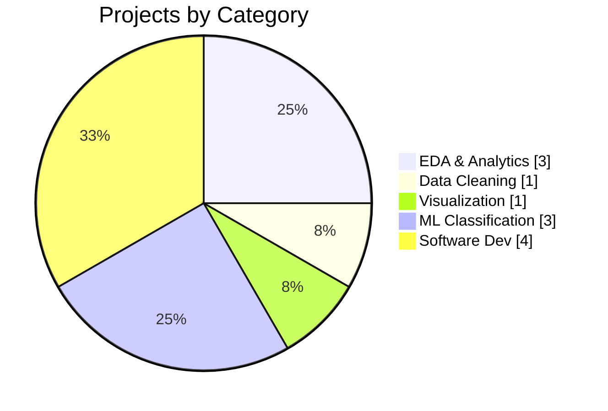
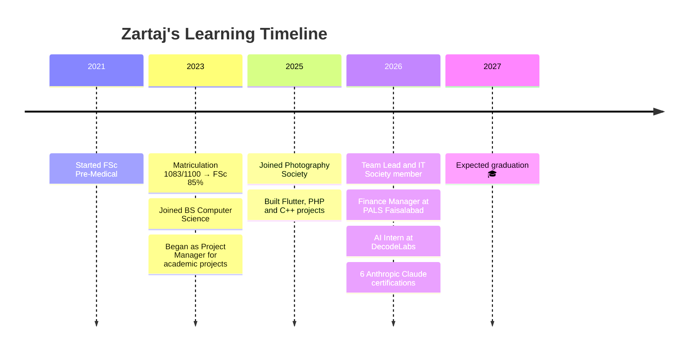
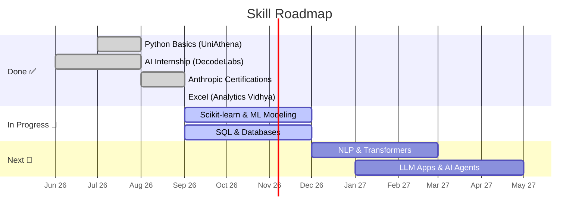

<!-- ============ HEADER BANNER ============ -->

  

  

  
  
  
  

---

## 👩‍💻 About Me

<table>
<tr>
<td width="60%" valign="top">

I'm a **BS Computer Science** student at **Superior University Faisalabad** and a recent **AI Intern at DecodeLabs**.

I started with software development (Flutter, PHP, C++) and now apply that problem-solving mindset to **data**: cleaning messy datasets, exploring them until they tell a clear story, and evaluating ML models honestly instead of chasing one metric.

- 🔭 Exploring: **ML, NLP, Generative AI & AI Agents**
- 🌱 Learning: **Scikit-learn, SQL, LLM apps**
- 💬 Ask me about: **Python, EDA, data cleaning, classification**
- 🎯 Open to: **Internships & entry-level Data / ML roles**

> **Build. Learn. Improve. Repeat.**

</td>
<td width="40%" valign="top" align="center">

| 🎓 Quick Facts | |
|---|---|
| **Degree** | BS Computer Science |
| **CGPA** | 3.88 / 4.00 |
| **Graduation** | 2027 |
| **Focus** | Data Analysis · ML |
| **Location** | Faisalabad, PK 🇵🇰 |
| **Certifications** | 9+ |
| **Projects** | 11+ |

</td>
</tr>
</table>

---

## 🛠️ Tech Stack

  

### 📊 Proficiency

| Skill | Level | |
|---|---|---|
| 🐍 Python | 85% |  |
| 🐼 Pandas & NumPy | 80% |  |
| 📈 Matplotlib & Seaborn | 80% |  |
| ⚙️ C++ & OOP | 80% |  |
| 🔀 Git & GitHub | 75% |  |
| 🌐 Web Dev (HTML/CSS/PHP) | 70% |  |
| 🧠 Scikit-learn | 65% |  |
| 🗄️ SQL & Databases | 60% |  |

### 🥧 My Project Mix

---

## 🔄 My Data Science Workflow

```mermaid
flowchart LR
    A[📥 Raw Data] --> B[🧹 Clean<br/>nulls · dupes · types]
    B --> C[🔍 Explore<br/>EDA · correlations]
    C --> D[📈 Visualize<br/>right chart for the question]
    D --> E[🧠 Model<br/>LogReg · RF · Trees]
    E --> F[✅ Evaluate<br/>ROC-AUC · reports]
    F --> G[📖 Tell the Story]
    style A fill:#fde68a,stroke:#333,color:#000
    style B fill:#bfdbfe,stroke:#333,color:#000
    style C fill:#bbf7d0,stroke:#333,color:#000
    style D fill:#fbcfe8,stroke:#333,color:#000
    style E fill:#ddd6fe,stroke:#333,color:#000
    style F fill:#fed7aa,stroke:#333,color:#000
    style G fill:#a7f3d0,stroke:#333,color:#000
```

---

## 📊 Featured Projects

### 🔬 Data Science & Machine Learning

| # | Project | Highlights | Stack | Type |
|:-:|---|---|---|:-:|
| 1 | 💎 **Diamond Price Analysis** | ~54K records · carat is the strongest price driver · cut/color/clarity comparison · luxury segment filter | `Pandas` `Seaborn` `Matplotlib` | 🟦 EDA |
| 2 | 📉 **Customer Churn Prediction** | Preprocessing pipeline · Logistic Regression vs Random Forest · ROC-AUC evaluation | `Pandas` `Scikit-learn` | 🟪 ML |
| 3 | 🛒 **E-Commerce Sales Analytics** | Monthly revenue & profit trends · category/region performance · top customers | `Pandas` `Seaborn` | 🟩 BI |
| 4 | 🧹 **E-Commerce Order Cleaning** | Null audit · imputed coupon codes · duplicate check · revenue & units ranking | `Pandas` | 🟨 Cleaning |
| 5 | 🎨 **Statistical Visualization Practice** | Box plots · CI line plots · grouped bars on tips/iris/Titanic | `Seaborn` `Matplotlib` | 🟥 Viz |
| 6 | 🌸 [**AI Data Classification**](https://github.com/zari12-dev/AI-Data-Classification) | Decision Tree on Iris · accuracy + classification report | `Scikit-learn` | 🟪 ML |
| 7 | 🤖 [**Rule-Based AI Chatbot**](https://github.com/zari12-dev/Rule-Based-AI-Chatbot) | Greetings, calculator, date/time, jokes, help menu | `Python` | 🤖 AI |

### 💻 Software Development

| Project | Description | Stack |
|---|---|---|
| 🏥 **Mediscan App** | Connects patients with diagnostic labs · real-time pricing & booking | `Flutter` `Dart` `Firebase` |
| 🎯 [**Future Finder**](https://github.com/zari12-dev/career-guidance) | Career counseling platform with AI chatbot roadmaps | `HTML` `CSS` `PHP` |
| 🏠 [**SaleHome System**](https://github.com/zari12-dev/RentHomesystem) | Real-estate portal with admin CRUD & property search | `HTML` `CSS` `JS` `PHP` |
| ✈️ **AirTrack Flight Booking** | Console reservation system with custom data structures | `C++` `OOP` |

> 💡 Full write-ups and live demos on my 👉 [**portfolio website**](https://zartajnadeem.netlify.app/)

---

## 📈 GitHub Analytics

  
  

  

  

### 🏆 Trophies

  

### 🐍 Contribution Snake

  

---

## 🗺️ My Journey

### 🎯 Learning Roadmap

---

## 🎓 Education & Certifications

| 🏫 Education | Period | Result |
|---|---|---|
| **BS Computer Science**, Superior University Faisalabad | 2023 – 2027 | CGPA **3.88 / 4.00** |
| **FSc Pre-Medical**, Aspire College Samundri | 2021 – 2023 | **85%** |
| **Matriculation**, Rehman Higher Secondary School | — | **1083 / 1100** |

| 🏅 Certification | Issuer | Topic |
|---|---|---|
| AI Fluency · Claude 101 · Platform 101 · Code 101 · Code in Action · Cowork | **Anthropic** | Prompt engineering, API, AI-powered apps |
| Introduction to Generative AI and Agents | **Microsoft** | GenAI & agents |
| Introduction to Modern AI | **Cisco Networking Academy** | AI fundamentals |
| Basics of Python | **UniAthena × Cambridge Intl.** | Python foundations |
| Excel: From Beginner to Expert | **Analytics Vidhya** | Data handling in Excel |
| 2026 Aspire Leaders Program | **Aspire Institute** | Leadership (40 hrs) |

---

## 🤝 Experience & Leadership

| Role | Organization | Period |
|---|---|---|
| 🤖 AI Intern | DecodeLabs (Remote) | Jun – Jul 2026 |
| 💰 Finance Manager | PALS Faisalabad Chapter | Feb 2026 – Present |
| 👥 Team Lead | Superior University | Jan 2026 – Present |
| 💻 IT Society Member | Superior University | Feb 2026 – Present |
| 📋 Project Manager (academic projects) | Superior University | Oct 2023 – Present |
| 📷 Photography Society Member | Superior University | Feb 2025 – Jan 2026 |

---

## 📝 Currently Tracking

| Goal | Status | Progress |
|---|:-:|---|
| Upload all data projects to GitHub | 🔄 In progress |  |
| Master Scikit-learn | 🔄 In progress |  |
| Strengthen SQL | 🔄 In progress |  |
| Explore NLP & Transformers | 📅 Planned |  |
| Build an LLM-powered app | 📅 Planned |  |
| Land a data / ML internship | 🎯 Goal |  |

---

## 📫 Let's Connect

  
  
  

<i>"Building intelligent solutions. Learning every day."</i> ✨

